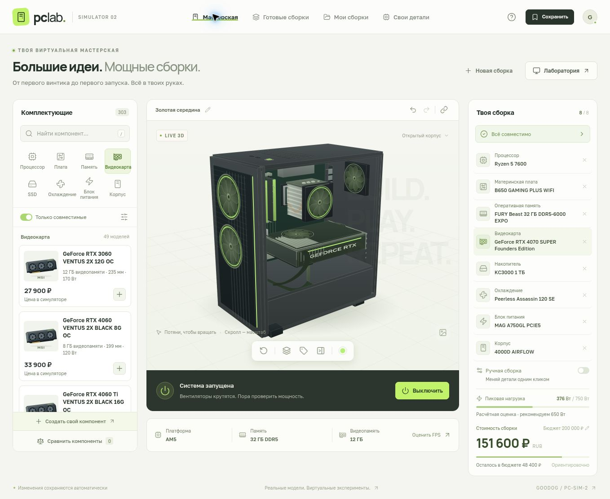

# PC-Sim-2 · PC Lab



[Русский](README.md) · **English**

A browser-based PC building simulator with a real hardware catalog, an interactive 3D chassis, compatibility checks, and an educational first-boot simulation. **The application interface is in Russian; this document provides the English project documentation.** Local use does not require a separate application server or database.

The built-in catalog contains **302 models and configuration variants**: 41 CPUs, 47 motherboards, 53 RAM kits/modules, 48 graphics cards, 29 SSDs, 27 cooling options, 26 PSUs, and 31 cases.

## Features

- Choose a CPU, motherboard, memory, graphics card, storage, cooling, power supply, and case.
- Search and sort the catalog, and filter compatible components.
- Inspect the build in 3D, rotate and zoom the camera, select components, change lighting, and use an exploded view.
- Change components instantly in sandbox mode or assemble the system step by step: install hardware, apply thermal paste, connect power, and attempt the first boot.
- Get explanations for socket, DDR, form-factor, clearance, cooling, connector, and PSU capacity conflicts.
- Start from a preset or build your own system from scratch.
- Add custom components in all eight categories through a specification editor, and combine them with the built-in catalog.
- Save builds in the browser, share them through a URL, and import/export JSON.
- Transfer the entire custom-component catalog through a separate import/export workflow.
- Compare simulated gaming performance across resolutions and quality settings.

## Real specifications and simulated values

**Built-in hardware names and core specifications come from manufacturer documentation.** Each component links to its official source. Sources and limitations are documented in [docs/HARDWARE_SOURCES.md](docs/HARDWARE_SOURCES.md). The additional CPU, motherboard, and RAM catalog is documented separately in [docs/PLATFORM_SOURCES.md](docs/PLATFORM_SOURCES.md); exact RAM part numbers were checked against individual manufacturer PDFs. Additional GPUs, SSDs, coolers, PSUs, and cases are documented in [docs/HARDWARE_EXPANSION.md](docs/HARDWARE_EXPANSION.md). Unverified optional specifications are marked as unknown; missing information does not mean confirmed compatibility.

The catalog covers AM4, AM5, and LGA1700, several CPU/GPU generations, case sizes, and memory kits. It is a curated collection rather than a complete inventory or a live store assortment. Cooler socket support is model-specific: older NH-L9i and NH-L9a-AM4 units do not automatically receive modern mounting support.

**Ruble prices are simulator prices.** They are not fetched from stores and do not represent current availability, discounts, or regional market prices. Build totals support the simulator's budget scenarios.

**FPS, 1% lows, temperatures, load power, and performance indices use an educational model.** They are not measured benchmarks or performance promises. The model uses illustrative CPU/GPU indices, resolution, and memory capacity/configuration. CPU and GPU indices use separate relative scales; they are not directly comparable measurements.

**The 3D components are procedural schematic representations.** They illustrate component placement and purpose, but are not exact manufacturer CAD models of every selected product. Clearance checks use catalog specifications rather than the displayed mesh geometry.

When WebGL is unavailable, the application automatically switches to a software 3D renderer built on Canvas2D. Rotation, zoom, component selection, lighting, exploded view, and image export remain available.

Before buying actual hardware, check the exact revision, CPU support list and BIOS version, memory QVL, cooler mounting kit, PSU cables, and radiator installation limits against manufacturer documentation. A few catalog fields cannot describe every physical and firmware requirement.

## Custom components

The editor stores up to **200 custom components** in the local catalog. Choose a category and enter a name, manufacturer, simulator price, and technical specifications. An optional source URL can be supplied. Custom records remain marked as user-defined: adding a URL does not make their specifications manufacturer-verified.

The **«Свои детали»** (Custom components) section lets you create, edit, and delete components. On a built-in component's detail card, **«Создать на основе»** (Create from this component) copies its specifications into the editor for modification. These records stay in your browser's personal catalog and are not published to the shared built-in catalog.

| Category | Main editor fields |
| --- | --- |
| CPU | Socket, RAM types, cores/threads, clocks, TDP, peak power, integrated graphics, and illustrative performance index |
| Motherboard | Socket, DDR generation, form factor, DIMM slots, maximum RAM capacity, and M.2 slots |
| RAM | DDR generation, total capacity, number of modules, MT/s, and module height |
| GPU | VRAM, power, length, slot width, power connectors, and illustrative performance index |
| SSD | NVMe capacity and estimated power |
| Cooling | Air/AIO, sockets, height or radiator size, RAM clearance, and illustrative thermal budget |
| PSU | Wattage, ATX/SFX/SFX-L format, length, and power connectors |
| Case | Supported motherboard/PSU formats, GPU/PSU length limits, cooler height, and radiator sizes |

Custom hardware participates in the same compatibility checks and calculations as built-in components. Results depend on the entered values. The editor validates types, required fields, numeric ranges, identifiers, and the optional HTTPS source URL. It does not verify that a product exists or that its author's specifications are accurate.

Fictional hardware is suitable for experiments. Its 3D representation remains schematic: entering a name and specifications does not generate an exact custom chassis or graphics-card model.

## Run locally

Install **Node.js 20.19 or newer** and npm. A current Node.js LTS release is a convenient choice for a new environment.

```bash
git clone https://github.com/Goodog2013/PC-Sim-2.git
cd PC-Sim-2
npm ci
npm run dev
```

Open the URL printed by Vite. Do not launch `index.html` by double-clicking it: the application uses JavaScript modules and bundled dependencies.

### Checks and production build

```bash
npm test
npm run check
npm run build
npm run preview
```

The production output is written to `dist/` and can be hosted by a static file service. `npm run preview` is for checking the production build locally.

GitHub Actions installs dependencies from the lock file, runs tests, and produces a production build. The workflow does not configure GitHub Pages or deploy the site automatically.

## Controls

Drag within the 3D viewport to rotate the camera, scroll to zoom, and click a component to select it. The viewport toolbar resets the camera and controls exploded view and other display settings. Touch screens support rotation and zoom gestures.

Sandbox mode changes components immediately. Manual assembly mode tracks physical prerequisites: for example, a CPU requires an installed motherboard, and a cooler requires an installed CPU. Successful simulated boot requires a compatible configuration, installed components, thermal paste, and connected power. A processor with integrated graphics can boot without a dedicated graphics card; a processor without integrated graphics needs an installed GPU.

## Saves and portability

Build saves and the custom catalog use the current browser's local storage. They do not synchronize across devices and can be removed when site data is cleared. Use JSON export or a configuration link for transfer or backup.

**Build exports and shared links include the definitions of the selected custom components**, so a configuration travels with its custom hardware. They do not include the entire personal catalog. Use the separate custom-catalog export/import to transfer all user-defined components.

Import validates structure, categories, identifiers, and specifications before applying data. A shared link's recipient must have access to the hosting location. Future changes to the built-in catalog may make old component identifiers unavailable.

## Project structure

| Path | Purpose |
| --- | --- |
| `src/main.js` | Application state, interface, and event handling |
| `src/ui.js` | Shared rendering helpers |
| `src/scene.js` | Three.js geometry, camera, and animation |
| `src/fallback-scene.js` | Software 3D renderer for browsers without WebGL |
| `src/catalog.js` | Components, categories, and presets |
| `src/catalog-extra-platforms.js` | Additional CPUs, motherboards, and exact RAM part numbers |
| `src/catalog-extra-hardware.js` | Additional GPUs, SSDs, cooling, PSUs, and cases |
| `src/custom-components.js` | Editor fields and custom-component validation |
| `src/engine.js` | Compatibility, assembly prerequisites, POST, and estimates |
| `tests/engine.test.js` | Compatibility, installation, and simulation tests |
| `docs/HARDWARE_SOURCES.md` | Hardware sources and data limitations |
| `docs/PLATFORM_SOURCES.md` | Individual sources for the CPU/motherboard/RAM expansion |
| `docs/HARDWARE_EXPANSION.md` | Sources for the other expansions and unknown specifications |
| `.github/workflows/ci.yml` | Push and pull-request checks |

The main stack is Vite, JavaScript ES modules, Three.js, and Lucide. Compatibility logic is independent of the DOM and 3D engine and is tested with Node.js's built-in test runner.

## Extending the catalog

For personal experiments, use the in-app editor. To extend the built-in catalog, add a component to the appropriate catalog module with a unique `id`, category, simulator price, source URL, and category-specific technical fields. Distinguish individual product verification, family-level sources, and unknown specifications. Do not copy one graphics-card variant's dimensions to another without a supporting source.

Presets reference component identifiers. When changing compatibility rules, add a test for an actual conflict or edge case in `tests/engine.test.js`. Custom-component schema changes should preserve import validation and save portability.

`coolingCapacity`, `score`, and simulator prices are model inputs. Do not present them as official specifications or measured results.

## License

The code is distributed under the [MIT License](LICENSE). Manufacturer and product names belong to their respective owners and are used to identify hardware. The project is not affiliated with component manufacturers.
